# 🐧 Ubuntu Server on AWS EC2 – From Virtual Machine to Live Website

> **Learn • Build • Visualize • Troubleshoot • Grow**
> An animated, beginner-friendly cloud-infrastructure simulator by **Cloud Messenger™**.
> `#buildwithCloud-Messenger`

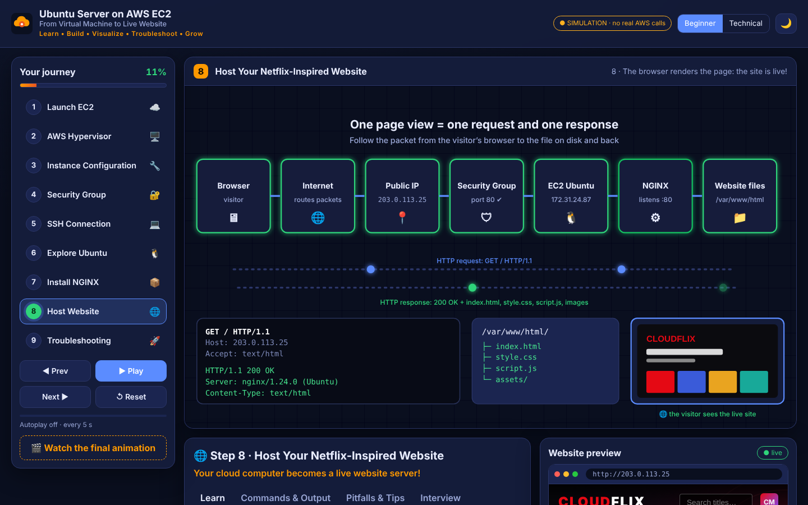

---

## 1. Project overview

**Ubuntu Server on AWS EC2** is a zero-dependency, interactive visualization that teaches the *complete* journey of publishing a website from a cloud server:

> launch an Ubuntu 24.04 LTS EC2 instance → understand the virtualization underneath → configure it → protect it with a Security Group → connect with SSH → explore Linux → install NGINX → host a streaming-style landing page → troubleshoot like a Cloud Support Engineer.

It is built with plain HTML, CSS and JavaScript (no framework, no build step, no backend) and works by simply opening `index.html` or by hosting it on GitHub Pages.

> ⚠️ **Everything in the visualizer is a simulation.** The page never contacts AWS, never launches real EC2 instances and never connects to a real server. Terminal output, IDs, dates and IPs are realistic *examples*. The public IP `203.0.113.25` is from the reserved documentation range (RFC 5737) and is not a real server. To do it for real, follow the [AWS EC2 Ubuntu deployment guide](#10-aws-ec2-ubuntu-deployment-guide) below.

**The story:** *Cloud Messenger wants to launch its own streaming platform.* A visitor types the public IP of an Ubuntu EC2 instance into a browser, and the visualization shows every hop: AWS infrastructure → hypervisor/Nitro → Ubuntu → Security Group → NGINX → HTML/CSS/JS → the visitor's screen.

## 2. Learning objectives

After finishing the nine steps you can explain and do the following:

- What Ubuntu, Amazon EC2, an AMI, an instance type, a VPC, a subnet and an Availability Zone are.
- What virtualization and a hypervisor are, and how the **AWS Nitro System** differs from traditional (Xen-style) virtualization.
- How CPU, RAM, storage (EBS) and networking are allocated to an instance.
- How a **Security Group** works (inbound/outbound rules, source IP, CIDR, stateful, least privilege).
- How **SSH public-key authentication** works and why a private key must never be shared.
- The Linux basics: filesystem, home directory, kernel, CPU/memory/disk usage and network interfaces.
- How **APT** installs software and how **NGINX** serves files from `/var/www/html`.
- How to diagnose and fix 12 classic EC2 / NGINX incidents.

## 3. Architecture diagram

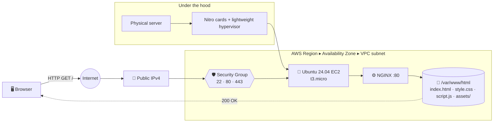

```text
AWS CLOUD
    ↓
PHYSICAL SERVER
    ↓
HYPERVISOR / NITRO ARCHITECTURE
    ↓
UBUNTU EC2 INSTANCE
    ↓
SECURITY GROUP
    ↓
SSH CONNECTION
    ↓
NGINX WEB SERVER
    ↓
HTML + CSS + JAVASCRIPT
    ↓
LIVE WEBSITE
```

More detail: [docs/architecture.md](docs/architecture.md).

## 4. The nine animated steps

Every step has an animated SVG diagram, a beginner/technical explanation toggle, a real-world analogy, commands with expected output, common mistakes, a troubleshooting tip and an interview question.

| # | Step | What the animation shows |
|---|---|---|
| 1 | ☁️ **Launch EC2** | Simulated console: pick Ubuntu 24.04 AMI, `t3.micro`, VPC/subnet, storage, key pair → an instance appears in a Region/AZ |
| 2 | 🖥️ **AWS Hypervisor** | Physical host → hypervisor/Nitro → three isolated VMs; resource allocation; Ubuntu kernel boots; Nitro explained accurately |
| 3 | 🔧 **Instance Configuration** | vCPU, memory, EBS, root filesystem, key pair, VPC, subnet, public IP; Pending → Running → 2/2 status checks |
| 4 | 🔐 **Security Group** | Packets approach the instance; allowed traffic passes, unauthorized traffic is dropped; stateful replies |
| 5 | 💻 **SSH Connection** | `chmod 400`, `ssh -i`, port 22 check, public-key challenge, encrypted tunnel, Ubuntu welcome banner |
| 6 | 🐧 **Explore Ubuntu** | Filesystem tree, kernel, CPU/RAM/disk gauges, network interface + **interactive terminal & command explorer** |
| 7 | 📦 **Install NGINX** | `apt update` / `upgrade` / `install nginx` with progress bars, packages flowing from the repository |
| 8 | 🌐 **Host Website** | Browser → Internet → Public IP → Security Group → EC2 → NGINX → files → browser, with live **CloudFlix** preview |
| 9 | 🚀 **Troubleshooting** | Control room with 12 interactive incidents and a final production health check |

At the end, a **cinematic finale** stacks the whole architecture and shows a live website preview with confetti. 🎉

### Screenshots

| Step 1 – Launch EC2 | Step 2 – Hypervisor / Nitro |
|---|---|
| 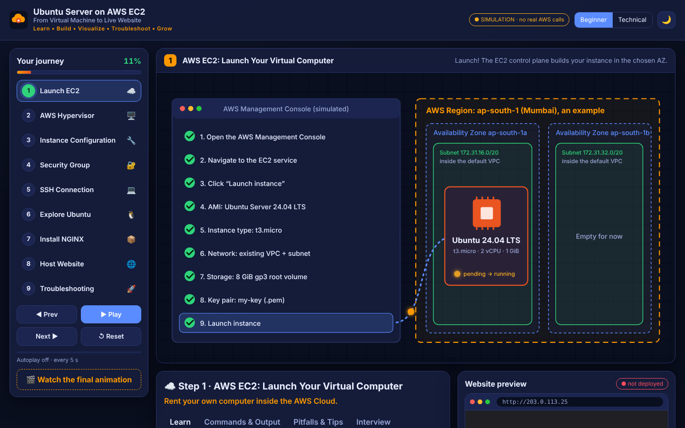 | 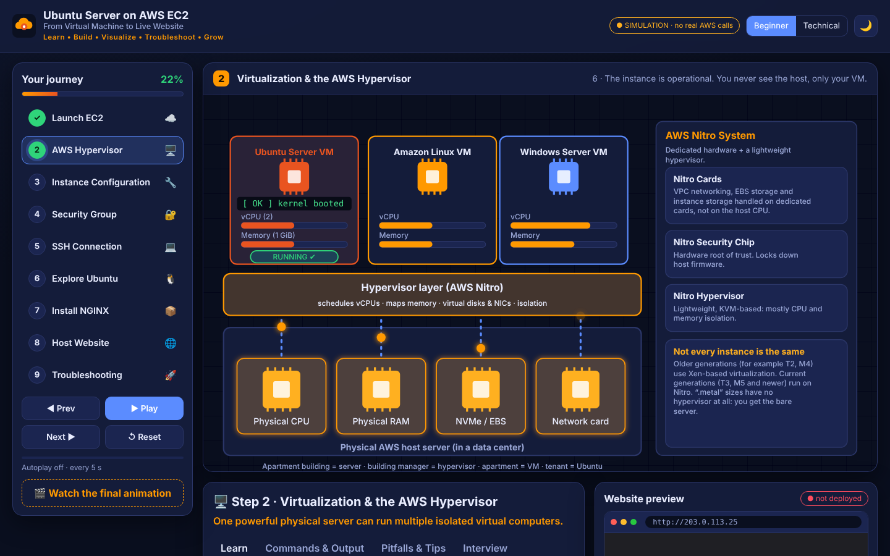 |

| Step 4 – Security Group | Step 5 – SSH |
|---|---|
| 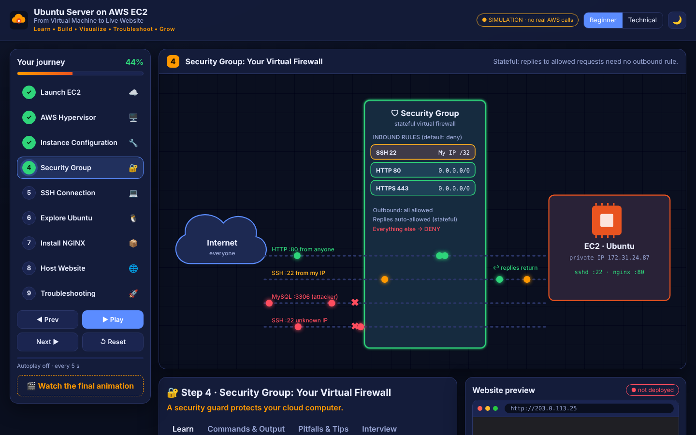 | 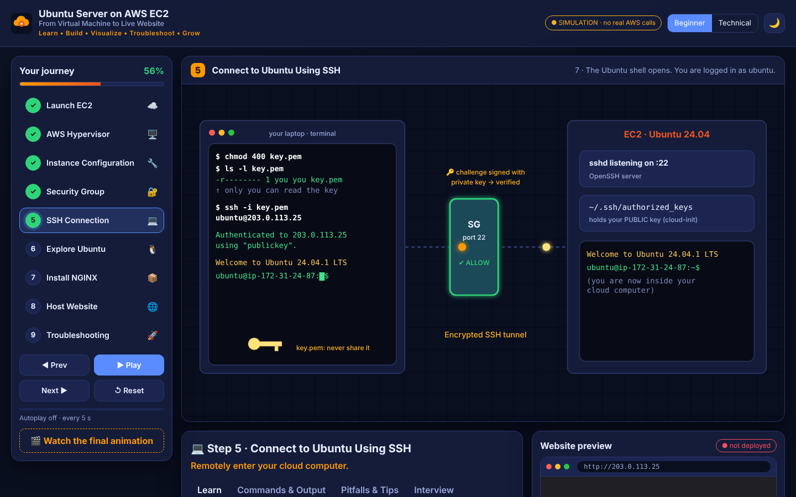 |

| Step 6 – Explore Ubuntu | Step 7 – Install NGINX |
|---|---|
| 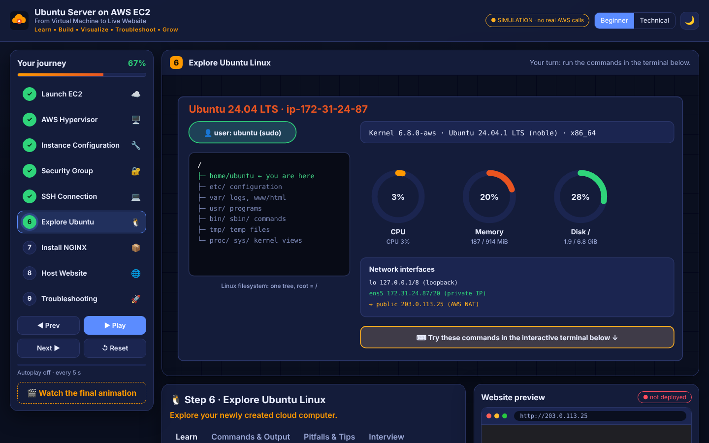 | 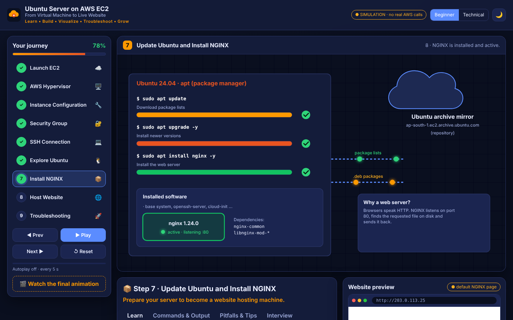 |

| Step 9 – Incident (NGINX stopped) | Final animation |
|---|---|
| 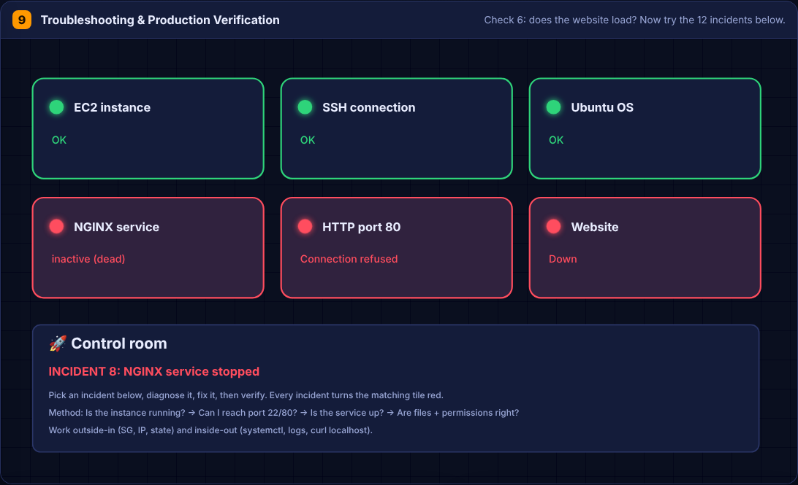 | 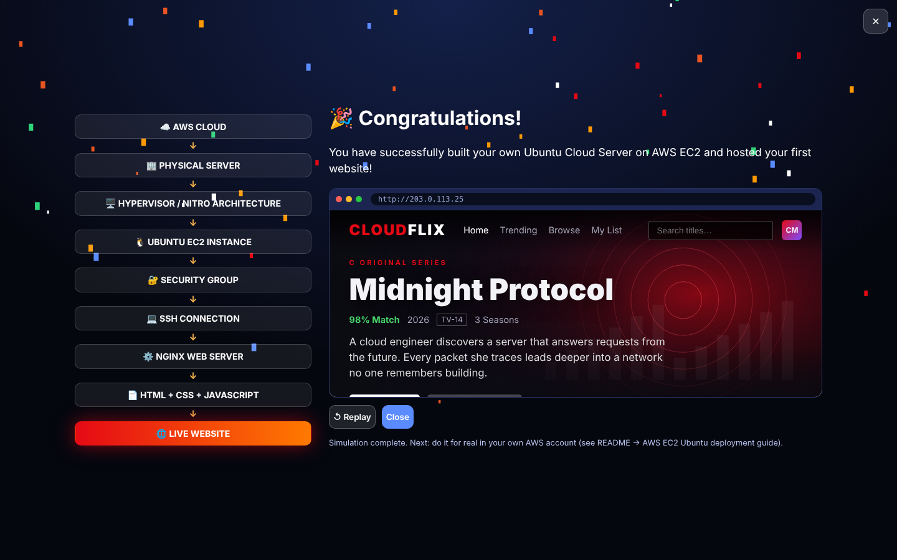 |

| Interactive terminal | Mobile |
|---|---|
| 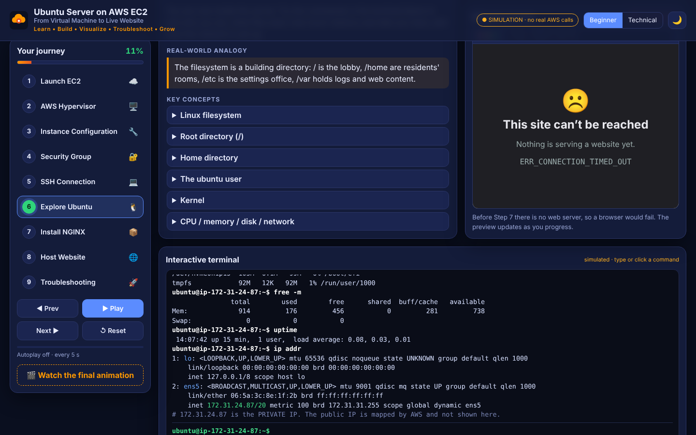 | 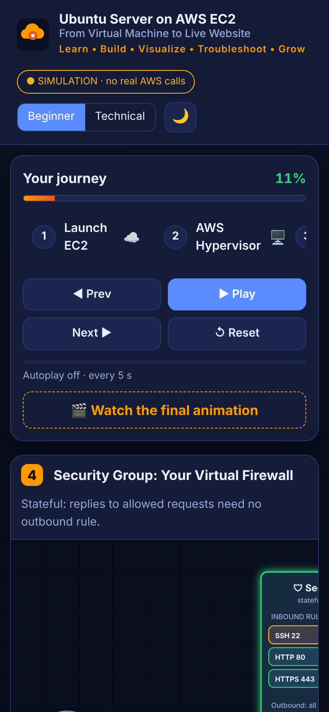 |

## 5. Technologies used

- **HTML5, CSS3 (custom properties, grid), vanilla JavaScript (ES5-style IIFEs)**: no framework, no build step, no backend.
- **Inline animated SVG** driven by a small beat/packet engine (`requestAnimationFrame` + `getPointAtLength`).
- Light and dark themes (system preference + toggle, saved in `localStorage` when available).
- Accessible controls: keyboard navigation (← → Space Esc), ARIA labels, reduced-motion support.
- **CloudFlix** demo site: original SVG artwork, no copyrighted assets, no external requests.

## 6. Project structure

```text
ubuntu-ec2-visual/
├── index.html
├── README.md · LICENSE · .gitignore · .nojekyll
├── css/    style.css · animation.css · responsive.css
├── js/     app.js · steps.js · terminal.js · animation.js · troubleshooting.js
├── assets/
│   ├── aws-cloud/ · ubuntu/ · hypervisor/ · nginx/ · icons/   (illustrations, logo, favicon)
│   └── website/   index.html · style.css · script.js · assets/   ← the CloudFlix site you deploy
└── docs/   architecture.md · deployment-guide.md · troubleshooting-guide.md · linkedin-post.md · screenshots/
```

## 7. How to run locally

**Option A – just open it:** double-click `index.html` (works from `file://`).

**Option B – tiny local server (recommended):**

```bash
cd ubuntu-ec2-visual
python3 -m http.server 8000
# open http://localhost:8000
```

Controls: **Play/Pause** (autoplay every 5 s), **Prev/Next**, **Reset**, **Beginner/Technical** toggle, theme switch, and **🎬 Watch the final animation**. Deep link to a step with `index.html#8`.

Validate the JavaScript:

```bash
node --check js/app.js
node --check js/steps.js
node --check js/terminal.js
node --check js/animation.js
node --check js/troubleshooting.js
```

## 8. GitHub repository setup

```bash
cd ubuntu-ec2-visual
git init
git add .
git commit -m "Initial commit: Ubuntu Server on AWS EC2 visual"
git branch -M main
git remote add origin https://github.com/<YOUR-USER>/ubuntu-ec2-visual.git
git push -u origin main
```

## 9. GitHub Pages deployment

1. Push the repo to GitHub (above).
2. **Settings → Pages → Build and deployment → Source: “Deploy from a branch”**.
3. Branch: `main`, folder: `/ (root)` → **Save**.
4. After about a minute the site is live at `https://<YOUR-USER>.github.io/ubuntu-ec2-visual/`.

The included `.nojekyll` file tells GitHub Pages to serve the files as they are.

## 10. AWS EC2 Ubuntu deployment guide

> This is the **real** thing the simulator teaches. It creates billable AWS resources: stop/terminate them when you finish. Free-tier or credit eligibility of `t3.micro` depends on your account and Region.

1. **Console → EC2 → Launch instance.**
2. **Name:** `ubuntu-web`. **AMI:** *Ubuntu Server 24.04 LTS* (publisher: Canonical).
3. **Instance type:** `t3.micro` (or what your account offers).
4. **Key pair:** create one (RSA or ED25519, `.pem`) and **download it once**.
5. **Network settings:** choose your VPC and a *public* subnet, **Auto-assign public IP: Enable**.
6. **Security group** (see [Step 4](#4-the-nine-animated-steps)):

| Type | Port | Source | Why |
|---|---:|---|---|
| SSH | 22 | **My IP** (`x.x.x.x/32`) | Remote administration, least privilege |
| HTTP | 80 | `0.0.0.0/0` | Public website |
| HTTPS | 443 | `0.0.0.0/0` | Only useful after you configure TLS |

7. **Storage:** 8 GiB gp3 (default). **Launch instance.** Wait for **Running** and **2/2 checks passed**.

## 11. SSH connection instructions

```bash
chmod 400 key.pem
ssh -i key.pem ubuntu@<PUBLIC-IP>
```

- The default user on Ubuntu AMIs is **`ubuntu`** (not `ec2-user`).
- On Windows 10/11 use PowerShell/Windows Terminal (OpenSSH is built in) or PuTTY (convert the key with PuTTYgen).
- Never share or commit your `.pem` (the included `.gitignore` already excludes `*.pem`).
- `Connection timed out` → Security Group/IP/route problem. `Permission denied (publickey)` → wrong user or wrong key. See [Troubleshooting](#14-troubleshooting-guide).

## 12. NGINX installation

```bash
sudo apt update
sudo apt upgrade -y
sudo apt install nginx -y
sudo systemctl enable --now nginx
sudo systemctl status nginx
curl -I http://localhost
```

Open `http://<PUBLIC-IP>` in your browser: you should see **“Welcome to nginx!”**. (This requires port 80 in the Security Group.)

## 13. Website deployment

**Method A – Git clone (needs the repo published):**

```bash
sudo apt update
sudo apt install nginx git -y
git clone https://github.com/Cloud-Messenger/ubuntu-ec2-visual.git
sudo cp -r ubuntu-ec2-visual/* /var/www/html/
sudo systemctl enable --now nginx
```

This publishes the whole visualizer at `http://<PUBLIC-IP>/`. To publish **only the CloudFlix demo site** instead:

```bash
sudo cp -r ubuntu-ec2-visual/assets/website/* /var/www/html/
```

**Method B – upload the ZIP with SCP (no GitHub needed):**

```bash
# on your laptop
scp -i key.pem ubuntu-ec2-visual.zip ubuntu@<PUBLIC-IP>:~

# on the server
sudo apt install unzip nginx -y
unzip ubuntu-ec2-visual.zip
sudo cp -r ubuntu-ec2-visual/* /var/www/html/
sudo systemctl enable --now nginx
```

To use the exact commands from Step 8 (`sudo cp -r website/* /var/www/html/`), upload the CloudFlix folder as `~/website` first:

```bash
scp -i key.pem -r ubuntu-ec2-visual/assets/website ubuntu@<PUBLIC-IP>:~/website
ssh -i key.pem ubuntu@<PUBLIC-IP>
sudo cp -r website/* /var/www/html/
curl http://localhost
```

> **Notes**
> - `https://github.com/Cloud-Messenger/ubuntu-ec2-visual.git` is a **placeholder** until you publish the repository under that name.
> - The commands assume you run them from the directory that contains the cloned/unzipped folder, as the `ubuntu` user with `sudo` rights. `/var/www/html` is owned by root, so copying needs `sudo`.
> - **HTTPS** needs a domain name, a TLS certificate (for example Let's Encrypt via `certbot`) and port 443 in the Security Group. The demo uses plain HTTP.

## 14. Troubleshooting guide

Quick method: **AWS side** (instance running? Security Group? public IP? route?) → **OS side** (`systemctl`, `nginx -t`, logs, `df -h`, `ss -tulpn`) → **files** (location and permissions).

| # | Symptom | Likely root cause | Diagnose | Fix |
|---|---|---|---|---|
| 1 | SSH timed out | No port-22 rule for your IP / no public IP / no route | `ssh -v …`, check SG | Add SSH from *My IP*; check IGW route |
| 2 | Permission denied (publickey) | Wrong user or key | `ssh -v …` | Use `ubuntu@` and the right `.pem` |
| 3 | Port 22 blocked | Your IP changed (/32 rule) | `nc -vz IP 22` | Update the rule to *My IP* |
| 4 | HTTP not loading | SG / service / IP | `curl -I http://localhost` | Split inside vs outside |
| 5 | Port 80 blocked | No HTTP rule / NACL | `curl -m 5 http://IP` | Add HTTP 80 from `0.0.0.0/0` |
| 6 | Wrong public IP | IP changed after stop/start | Console → Public IPv4 | Use the new IP or an Elastic IP |
| 7 | Instance stopped | Stopped manually | `describe-instances` | Start it |
| 8 | NGINX stopped | Service inactive | `systemctl status nginx` | `sudo systemctl enable --now nginx` |
| 9 | Default NGINX page | Files not in `/var/www/html` | `ls /var/www/html` | `sudo cp -r website/* /var/www/html/` |
| 10 | 403 Forbidden | Bad file permissions | `tail /var/log/nginx/error.log` | `chmod 755` dirs / `644` files |
| 11 | Disk full | 8 GiB root volume exhausted | `df -h` | `apt clean`, vacuum logs, grow EBS |
| 12 | NGINX config error | Syntax error | `sudo nginx -t` | Fix, `nginx -t`, restart |

Each incident is playable in Step 9 with diagnostic, expected output, corrective action and verification. Full details: [docs/troubleshooting-guide.md](docs/troubleshooting-guide.md).

Useful commands:

```bash
sudo systemctl status nginx
sudo systemctl restart nginx
sudo nginx -t
sudo journalctl -u nginx -n 50
curl -I http://localhost
df -h
free -m
ss -tulpn
```

## 15. Interview preparation questions

1. What is the difference between an AMI and an instance?
2. What do vCPU and instance type mean? What does the `t3` family (burstable) imply?
3. What is a VPC, a subnet and an Availability Zone? How are they related?
4. What is the AWS Nitro System? Do all EC2 instances use the same hypervisor? *(No: older generations are Xen-based, current ones Nitro, `.metal` has none.)*
5. Type 1 vs Type 2 hypervisor: give examples.
6. What does stateful mean for a Security Group? Do you need an outbound rule for replies?
7. Security Group vs Network ACL?
8. Why use `My IP` (/32) for SSH instead of `0.0.0.0/0`?
9. How does SSH public-key authentication work? Which key goes on the server?
10. Why `chmod 400 key.pem`?
11. What is the default user on an Ubuntu AMI?
12. What does `apt update` do versus `apt upgrade`?
13. Where does NGINX serve files from by default on Ubuntu?
14. `curl localhost` works but the browser times out: what do you check?
15. Your public IP changed after a stop/start: why, and how do you prevent it? *(Elastic IP.)*
16. What is the difference between `reload` and `restart` for NGINX, and why run `nginx -t` first?
17. How do you add HTTPS to this site?

## 16. Credits and licensing

**Created by: Cloud Messenger™** · 🌐 <https://cloudmessenger.in/> · 💼 [LinkedIn](https://www.linkedin.com/in/ulhas-narwade-aws-certified-devops) · 🐙 [GitHub](https://github.com/Cloud-Messenger)

*Made with care by Cloud Messenger™ · © 2026 Cloud Messenger. All rights reserved.*

The compilation, educational structure, original visualizations, layout and branding are the original work of Cloud Messenger. Third-party trademarks, logos and properly licensed assets remain the property of their respective owners. AWS, Amazon EC2, Ubuntu and NGINX are trademarks of their respective owners; this is an independent educational project and is not affiliated with or endorsed by them.

**CloudFlix** is a fictional demo brand with original artwork, inspired by the general look of streaming apps. It contains no third-party source code or assets and is not affiliated with any streaming company.

Source code is released under the [MIT License](LICENSE).

`#buildwithCloud-Messenger` — **Learn • Build • Visualize • Troubleshoot • Grow**
